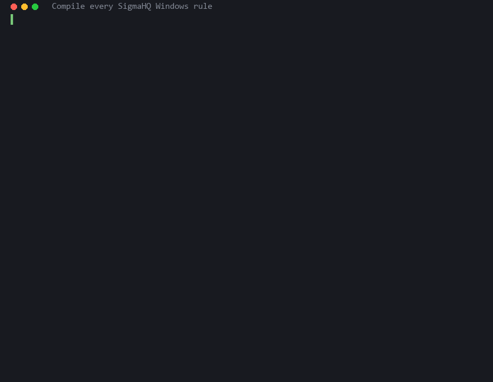
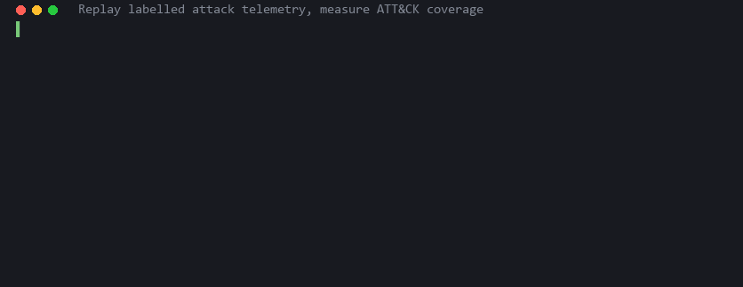
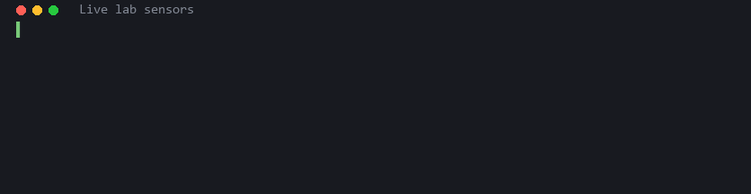
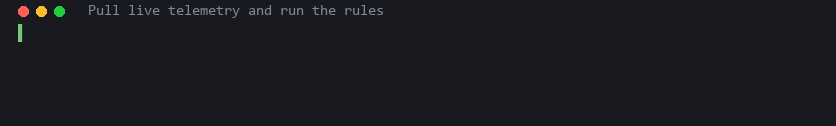
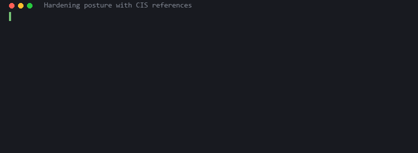
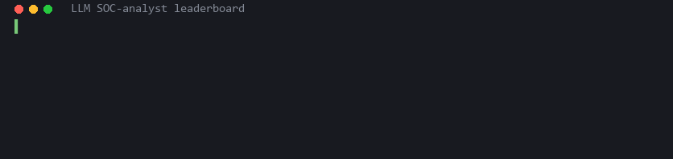

# RangeForge

**Detection engineering lab and LLM SOC-analyst benchmark, built on real host telemetry.**

RangeForge turns a small Hyper-V lab (Windows Server + Ubuntu + Kali) into a
reproducible detection-engineering workbench and uses it to answer two
questions with numbers instead of opinions:

1. *How much of ATT&CK does my rule set actually catch on real attack telemetry?*
2. *How good is a given LLM at triaging the alerts that rule set produces?*

It is strictly defensive. Nothing in this repository generates attacks; it
ingests, detects, measures and benchmarks.

```
                 ┌──────────────┐    ┌──────────────┐    ┌───────────────────┐
  EVTX datasets  │   ingest     │    │   detect     │    │   coverage        │
  live Windows ─▶│ OCSF events  │───▶│ Sigma → py   │───▶│ ATT&CK heat-map   │
  live Linux     │ + native map │    │ predicates   │    │ noisy rules, gaps │
                 └──────────────┘    └──────┬───────┘    └───────────────────┘
                                            │ alerts + context
                                            ▼
                                     ┌──────────────┐    ┌───────────────────┐
                                     │   bench      │───▶│  leaderboard      │
                                     │ triage tasks │    │ verdict, ATT&CK,  │
                                     │ model runs   │    │ cost, refusals    │
                                     └──────────────┘    └───────────────────┘
```

## Demos

Every GIF below is real output, rendered by `tools/make_demo_gifs.py` from a
captured run (no screen recorder, reproducible with `--cached`).

| | |
|---|---|
| **Compile every SigmaHQ Windows rule**<br> | **Measure ATT&CK coverage on labelled telemetry**<br> |
| **Live lab sensors**<br> | **Pull live telemetry and run the rules**<br> |
| **Hardening posture with CIS references**<br> | **LLM SOC-analyst leaderboard**<br> |

## What is in the box

| Layer | What it does | Status |
|---|---|---|
| `rangeforge.schema` | OCSF-aligned `NormalizedEvent` with a flat *native* field view, so Sigma rules run on the names they were written for | done |
| `rangeforge.ingest` | Windows Sysmon / Security / PowerShell (EVTX files or live) and Linux auditd normalizers | done |
| `rangeforge.detect` | Sigma rules compiled straight into Python predicates; **all 2,636 SigmaHQ Windows + Linux rules compile with zero failures**; event-id indexed streaming engine; Sigma correlation rules (count / value-count / temporal / ordered) in-stream, evaluated over event-time windows with a watermark and a 30 s lateness buffer so out-of-order collector batches cannot forge or miss a sequence | done |
| `rangeforge.datasets` | Catalog + on-demand fetch of public, ATT&CK-labelled telemetry (EVTX-ATTACK-SAMPLES) | done |
| `rangeforge.coverage` | Replay labelled samples, score technique/tactic coverage, export an ATT&CK Navigator layer | done |
| `rangeforge.lab` | Inventory, SSH/WinRM transports, incremental collectors for live hosts, telemetry provisioning scripts | done |
| `rangeforge.bench` | SOC-analyst triage benchmark: task construction, model backends, resumable runner, scoring, leaderboard | done |
| `rangeforge.harden` | Read-only posture collectors, 51 CIS-referenced checks mapped to ATT&CK, snapshot drift | done |

## Results so far

**Detection coverage** of the full SigmaHQ Windows rule set (2,425 rules) against
EVTX-ATTACK-SAMPLES (270 captures, 36,564 events, every capture carrying a hand-reviewed technique label):

| metric | value |
|---|---:|
| samples with at least one alert | 73% |
| captures where a rule tagged with the *right* technique fired | 38% (102/270) |
| best tactic (any alert) | privilege-escalation, 86% |
| worst tactic (any alert) | discovery, 45% |

The per-technique heat-map is in [`docs/results/navigator-layer.json`](docs/results/navigator-layer.json)
(load it in the [ATT&CK Navigator](https://mitre-attack.github.io/attack-navigator/)); the
full table with noisy rules and missed samples is in
[`docs/results/coverage-summary.md`](docs/results/coverage-summary.md).

**SOC-analyst benchmark** (154 triage tasks: 116 malicious from labelled attack
telemetry, 38 benign from the lab's own administrative noise): see
[`docs/results/leaderboard.md`](docs/results/leaderboard.md) and the methodology
in [`docs/benchmark.md`](docs/benchmark.md).

## Quick start

```bash
git clone https://github.com/adilalperenciftci/rangeforge && cd rangeforge
python -m venv .venv && .venv/Scripts/activate      # or: source .venv/bin/activate
pip install -e ".[dev,lab]"

rf rules pull                      # sparse-clone SigmaHQ rules into data/cache
rf rules stats                     # compile them, see level / tactic breakdown
rf datasets list --tactic credential-access
rf coverage run                    # replay every sample, write runs/<ts>/{summary.md, navigator-layer.json}
```

Only Windows EVTX ingest needs no lab; everything above runs on a laptop.

### With a lab

Describe your hosts in `lab.yaml` (secrets are referenced by path only), then:

```bash
rf lab status                      # reachability + sensor state
rf lab collect --detect            # pull new events, run the rules, print alerts
```

Provisioning scripts for a well-instrumented target live in `infra/`:
`Enable-Telemetry.ps1` (Sysmon + audit policy + PowerShell logging) and
`enable-telemetry.sh` (auditd rule set).

### Check hardening posture

```bash
rf harden check --out docs/results/posture.md   # 30 Windows + 21 Linux checks, snapshot stored
rf harden drift windows                          # what changed since the previous snapshot
```

### Benchmark a model

```bash
rf bench build --benign data/live/windows.jsonl --benign data/live/ubuntu.jsonl
rf bench run -b claude-cli -m claude-sonnet-5-5     # Claude Code login, no API key
rf bench run -b codex-cli                           # Codex CLI login, no API key
rf bench run -b anthropic -m claude-opus-5-5        # ANTHROPIC_API_KEY
rf bench run -b ollama -m llama3.1:8b               # local
rf bench report --out docs/results/leaderboard.md
```

Runs are resumable: interrupt and re-run to fill the gaps.

## Design notes

- **Two views of every event.** OCSF gives correlation and reporting a stable,
  typed shape. The flat native map keeps Sigma rules running unmodified; no
  lossy field re-mapping, no backend-specific query language.
- **Rules are compiled once, evaluated in-process.** The pySigma AST becomes a
  closure; the whole SigmaHQ Windows set loads in under ten seconds and
  evaluates a few hundred to a few thousand events per second per core,
  depending on how much PowerShell script-block text the stream carries.
- **Ground truth comes from outside the system.** Coverage uses public datasets
  labelled by their authors. Benchmark tasks never show the model the dataset
  file name, the label, or the rule's verdict.
- **Benign tasks are real.** They are alerts the rules raised on the lab's own
  monitoring and provisioning activity: the kind of noise analysts actually see.

## Lab

Three Hyper-V VMs on two virtual switches: a NAT network with internet for the
sensors, and a private network for an isolated Kali host that is never used as
an attack source by this project. Checkpoints (`clean-install`, `pre-telemetry`)
make every provisioning step reversible.

## Contributing

Issues and pull requests are welcome, especially new dataset adapters, Linux
rule coverage, and additional model backends. Run `ruff check`, `ruff format`,
`mypy` and `pytest` before opening a PR; CI runs them on Linux and Windows.

## License

Apache-2.0. Datasets and rule sets are fetched from their upstream projects
at run time and keep their own licenses (SigmaHQ: DRL 1.1, EVTX-ATTACK-SAMPLES:
GPL-3.0); nothing from them is redistributed here.
